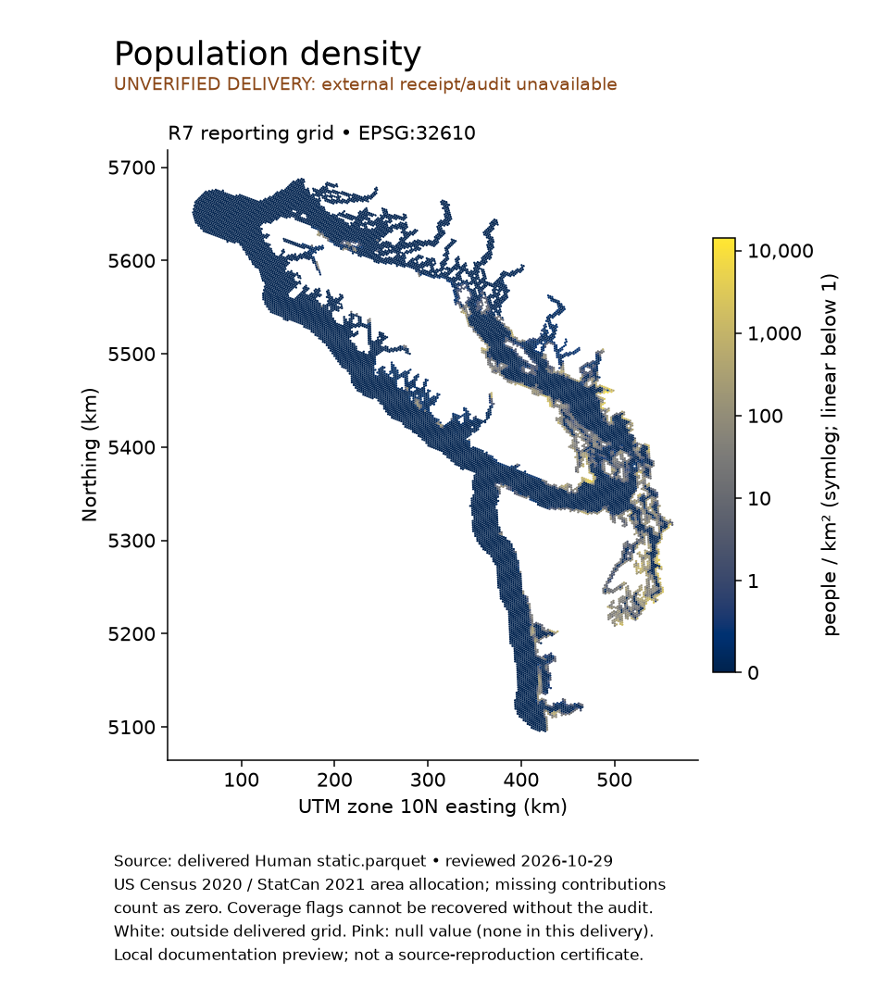
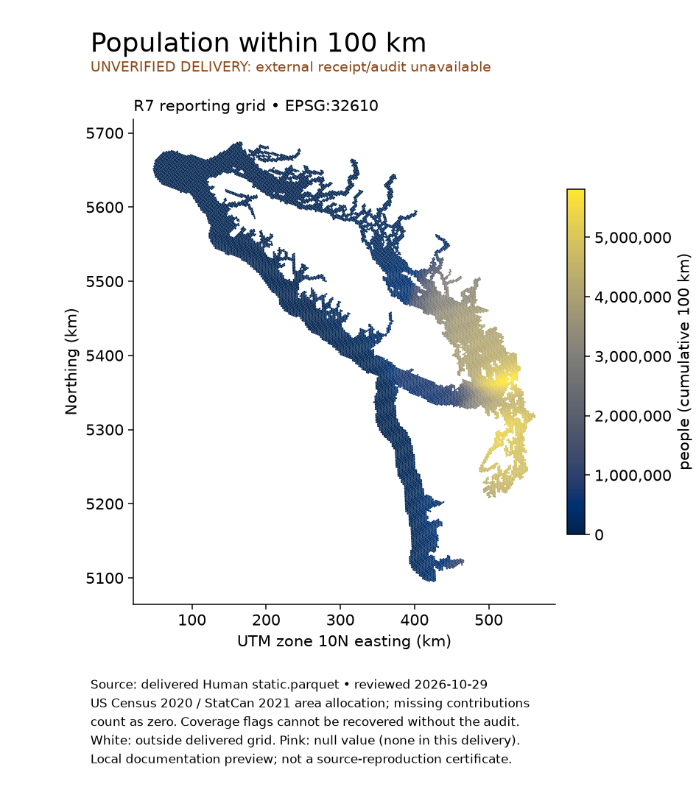
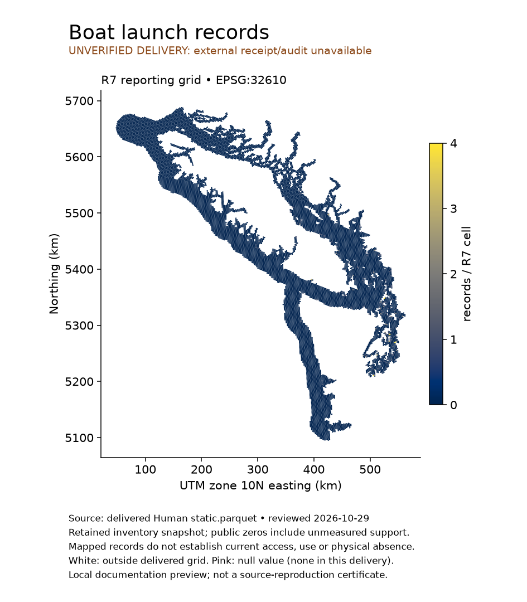
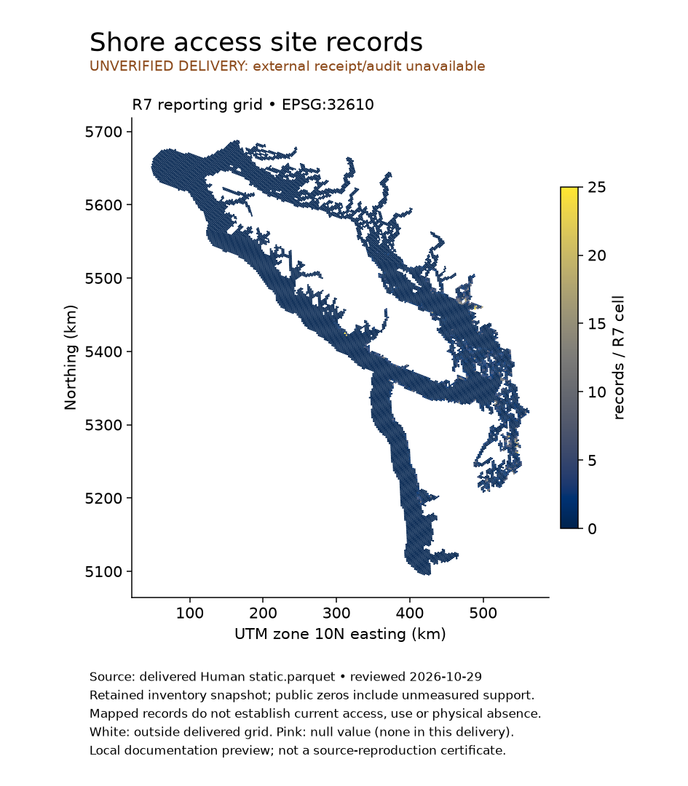
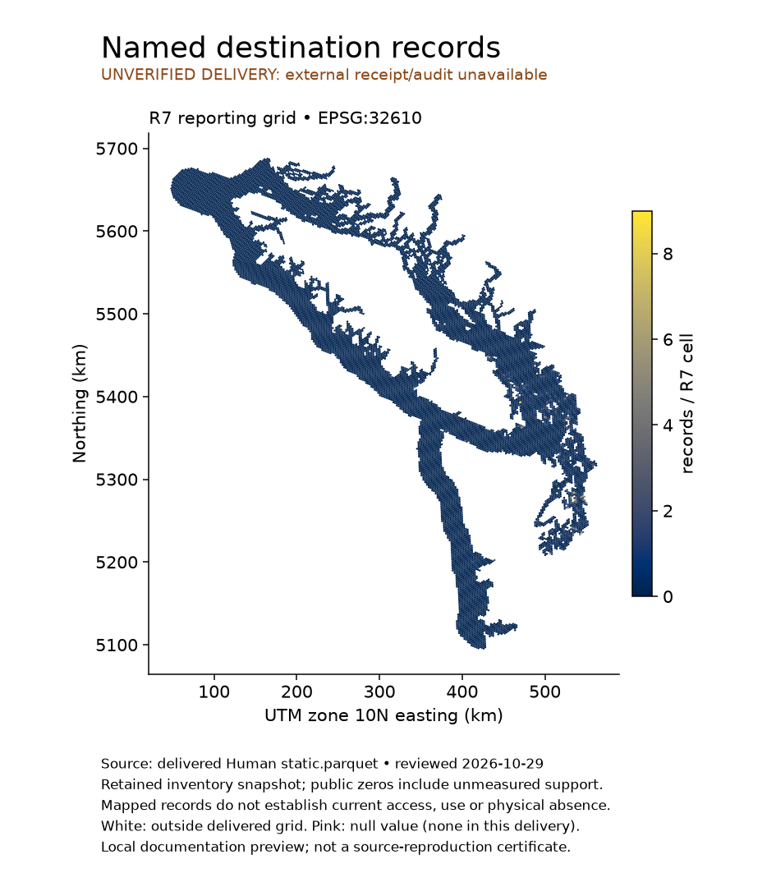
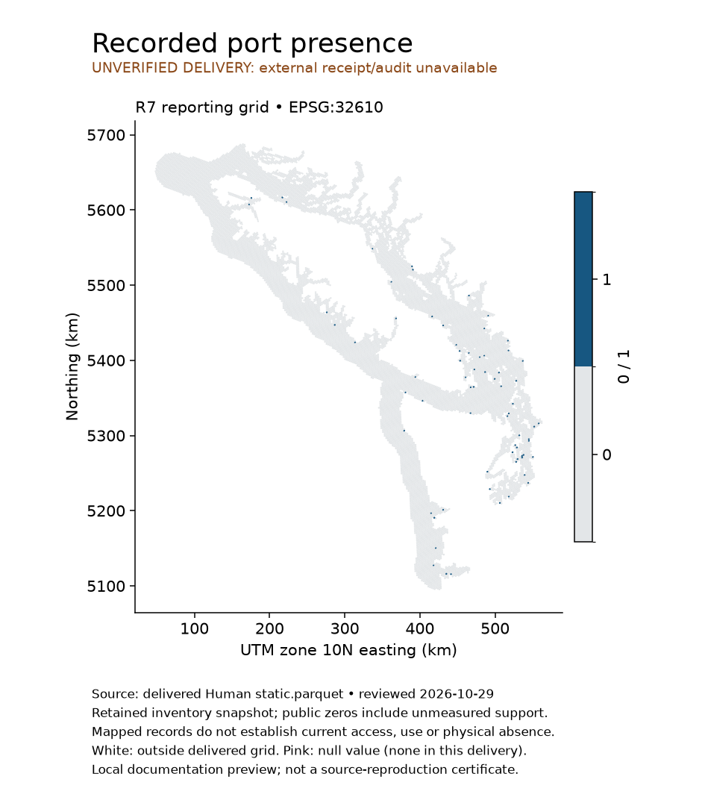
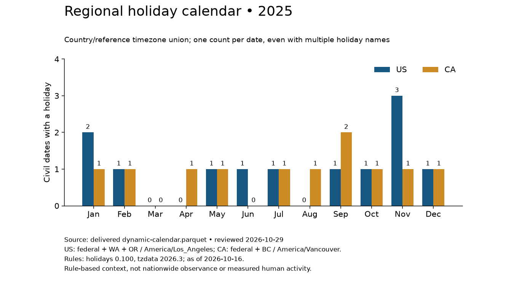

# Human reproducibility review — 2026-10-29

The current code reproduces **all 13,148 delivered calendar rows**, including all 11 columns, exact values, types, keys and nulls. **Static reproduction and complete delivery validation are blocked**: the configured retained census/native inputs, external catalog and mandatory static audit are unavailable at their recorded locations. The final Parquets remain unchanged. This review does not certify a clean acquisition, static historical replay or the application integration.

## What was reviewed

The supported entry points are `human.get_human_data`, `human get-human-data`, `python -m human` and `human validate`. The default recipe is `config/human.yaml`; packaged defaults live in `src/human/resources/config`. There are exactly two delivered products:

| Product | Delivered shape | Identity and support | Current result |
| --- | --- | --- | --- |
| `static.parquet` | 13,461 × 14 | Unique H3 R7 cell; US 2020 / Canada 2021 resident population; retained infrastructure snapshots | Values inspectable, full audit/replay blocked |
| `dynamic-calendar.parquet` | 13,148 × 11 | Civil date × country × reference timezone, inclusive 2009-01-01–2026-12-31 | Complete semantic replay passed |

Static columns are `h3_index`, `h3_resolution`, `population_count`, `population_within_25km`, `population_within_50km`, `population_within_100km`, `population_density_per_km2`, `boat_launch_count`, `shore_access_site_count`, `place_record_count`, `has_port`, `has_boat_launch`, `has_shore_access_site`, `has_place`. Counts/density are area allocations; radius quantities are cumulative geodesic neighborhoods, not distance rings or distance-to-feature layers. Neighborhoods overlap and cannot be summed. Public infrastructure zeros include unknown original support. Original nulls, population coverage flags and port multiplicities require the external audit; they cannot be inferred from the compact columns.

Calendar fields and join semantics are documented in [the pipeline guide](get-human-data.md). The US union covers federal/WA/OR; Canada covers federal/BC, with `America/Los_Angeles` and `America/Vancouver` reference zones. Date labels are civil dates, not UTC observations. Rule pins are `holidays==0.100`, `tzdata==2026.3`, as-of 2026-10-16. The replay covers actual/observed holiday names, weekends, ISO-year/week boundaries and all date fields. It found 221 US and 193 Canadian holiday dates over the delivered period. Future dates are rule-based context.

Manual Canadian acquisition is a supported user prerequisite, not an automation defect. The [manual source checklist](census-sources.md#manual-canadian-download-checklist) specifies official exports and ingestion. The absent historical receipt/audit below is a separate preservation gap.

## Exact missing dependencies and recovery options

Both Parquets embed this required receipt location, relative here to the toolkit checkout:

```
data/delivery/presence-20261025/catalog.json
```

The static metadata also requires `data/delivery/presence-20261025/static-audit.parquet`, 13,461 rows, SHA256 `59d035500cc84b1df8bb9b3dbb950440050d7de854db0030996588254b4a4770`. Neither file is present. The installed `human validate` fails with `FileNotFoundError` on that exact catalog path. This is also the consumer's missing external Human catalog problem; no application code was changed.

The configured `data/static-work/source-manifest-path.txt`, calculation cache `data/static-work/independent-review-20261017`, native store `data/sources/2026-10-17/native`, and pinned `data/sources/2026-10-14/ports/geometry.parquet` are absent. Original census fallback paths under `data/sources/census-us2020-ca2021` and `data/raw/statcan/2021` are absent too. The current toolkit `data/` contains only an empty processing directory and Finder metadata. This is a finding about current paths, not proof of deletion or absence from backups/other disks. Scoped searches of the workspace and retained `/tmp/human-*` artifacts did not locate the missing receipt/audit.

Resolution options:

1. Restore the original receipt **and matching audit** from a backup to their recorded paths, then run `human validate`. Verify the audit hash above and product hashes below. A relocated receipt needs an explicitly scoped migration of path bindings; merely pointing the app at arbitrary JSON is insufficient.
2. Restore matching normalized census bundle/source manifests, native snapshots, retained infrastructure support and pinned NGA geometry, then replay into an isolated output. The supplied recipe's native acquisition path represents a new snapshot unless the exact retained receipts are recovered. Exact historical parity requires matching identities and support masks.
3. If originals cannot be recovered, separately authorize a new source collection and new versioned delivery, preserving the existing files. It would produce a new catalog/audit but cannot be called recovery of the old snapshot. No full recollection was started here.

The embedded common catalog and product metadata could supply portions of a reconstructed catalog, but cannot reconstruct removed per-cell audit arrays. Generating catalog JSON alone would therefore not resolve the scientific validation failure. Source acquisition is also subject to official archive access/hash checks; prior 403 reports were not rechecked in this offline review.

## Re-run the verified calendar check

Use Python 3.11+ and the package's pinned dependencies. Build the current wheel in a small source snapshot if the live checkout must remain untouched, install it in an isolated environment, and run outside the source checkout without inherited `PYTHONPATH`:

```sh
python -m pip wheel --no-deps --no-build-isolation . -w /tmp/human-review-wheels
# Install the resulting wheel into your isolated environment with its dependencies.
python -m pip install /tmp/human-review-wheels/toolkit_human-0.1.0-py3-none-any.whl
cd /tmp
env -u PYTHONPATH PYTHONTZPATH='' python /path/to/toolkit-human/scripts/replay_calendar.py \
  /path/to/MarineCast/Data/Human /tmp/human-calendar-replay
```

The script reads bounds/as-of from delivered metadata, verifies rule versions, rebuilds through the installed calendar producer, compares every keyed row and Arrow field type, and writes only its scratch replay and evidence JSON. Equality is semantic; fresh Parquet metadata and encoding need not be byte-identical. This is an independent calendar producer replay, not a successful `get_human_data` run (that orchestration also requires static inputs).

For a full pipeline replay **after inputs are restored**, copy the configured recipe, point `work_dir` and `metadata_dir` to separate scratch directories, and retain exact existing source-store paths. Then use:

```sh
human --workspace /path/to/toolkit-human get-human-data \
  --config /tmp/human-review.yaml --mode offline \
  --output-dir /tmp/human-review-output --no-overwrite \
  --start-date 2009-01-01 --end-date 2026-12-31
human validate /tmp/human-review-output
```

Do not run the default command against approved Data/Human for a review. Check source and output identities, exact keyed values/nulls, population support and audit fields before any promotion. The [run guide](get-human-data.md), [source guide](census-sources.md) and [workflow checks](WORKFLOWS.md) specify external prerequisites and supported validation.

## Documentation examples

Install Matplotlib in addition to Human's base dependencies. The example script renders actual H3 cell boundaries in UTM 10N (EPSG:32610); no downloaded basemap is needed. Source hashes and summary statistics are written alongside the PNGs. The explicit preview flag permits only a missing-file validation failure; other validation errors still fail. It does not turn a preview into a validated product.

```sh
MPLCONFIGDIR=/tmp/human-mpl python scripts/make_review_examples.py \
  /path/to/MarineCast/Data/Human /tmp/human-example-maps --allow-unverified
```

These are local documentation previews of delivered values, not public source redistribution or certificates of provenance. White space lies outside the delivered grid. Pink marks null values (none occur in these public columns); missing support already encoded as zero cannot be separately painted without the audit. Density uses a labeled symmetric-log scale with a linear segment below 1 person/km²; other maps use their displayed linear scales. Each figure carries units, source/date and limitations. Population within 25/50 km uses the same cumulative method as the shown 100 km layer. Count presence counterparts are thresholded counts; port presence is shown separately because its underlying multiplicity is external.















## Validation evidence and preservation

Review baseline: commit `931404c0ff3009c05c1a35e7fadac8ecc6cca35b` **plus substantial pre-existing working-tree changes**, which were preserved. A regular wheel built from that current source snapshot has SHA256 `b26cedeff1cd21efc6e5c074b0b03cb937ea4a7338bdde270649642c35ec2dbe`. The isolated Python 3.14 environment used pandas 3.0.3 and PyArrow 24.0.0. The installed API/contract/CLI smoke check passed with imports resolved inside the wheel environment. No application imports were needed.

The documented supported pipeline selection passed 160 tests (one legacy test deselected), using installed package code and an isolated copied fixture workspace. An initial run used a fixture root without source/config files: two repository-layout checks failed, then passed after selecting the correctly populated isolated workspace; the complete selection was rerun. Pyflakes and the pipeline documentation/config/resource checks passed. The native GDAL/OSRM research suite, live raw acquisition and full static regional replay were not run. No behavioral code changes were needed.

Delivered preservation hashes:

| File | SHA256 |
| --- | --- |
| `static.parquet` | `a7ee7fff3c49490f4b9de89114d37eb1221c9464e0b433e33505e416ef6b8cee` |
| `dynamic-calendar.parquet` | `7b074434809f49fdb29317deee145606d04675e01bf43f789edc916b12b7ce3a` |

Bounded evidence and staging manifest: `/tmp/human-audit-20261029/`. It contains the source snapshot, wheel environment, test logs, replay, inventory and preview evidence; no bulk source archive was copied. Final figures were visually inspected for readable labels, geographic shape and no-data qualifications. No source deletion, credential changes, commits, pushes, publication or background processes were performed.
